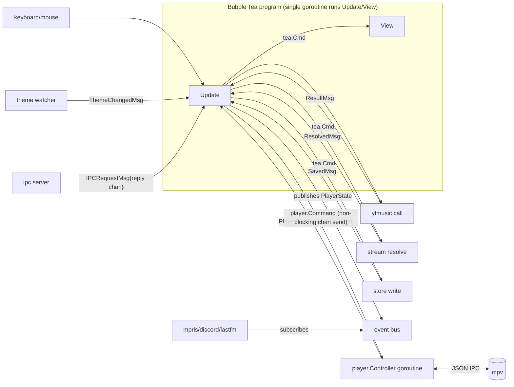

# 01 — Architecture

Status: **draft**, persistence implemented in M7 · Depends on: 00

## Goals

- `Update` never blocks. All I/O runs in `tea.Cmd`s or owned goroutines and comes back as messages.
- Every external system (mpv, InnerTube, yt-dlp, filesystem, clock, lrclib, D-Bus) sits behind a
  small interface with a fake.
- Explicit lifetimes: every goroutine has an owner, a `context.Context`, and a shutdown path.
- No cgo. `CGO_ENABLED=0` builds on linux/darwin/windows × amd64/arm64.

## Non-goals

- Plugin system, scripting language, multiple simultaneous accounts in one session.

## Dependencies (verified 2026-11-16 against proxy.golang.org / `go doc`)

| Purpose | Module | Version | Verified |
|---|---|---|---|
| TUI runtime | `charm.land/bubbletea/v2` | v2.1.1 | `go doc`: `KeyPressMsg`, `MouseClickMsg`, `BackgroundColorMsg`, `RequestBackgroundColor`, `ColorProfileMsg`, `WithColorProfile` exist |
| Styling | `charm.land/lipgloss/v2` | v2.1.1 | `NoColor`, `LightDark`, `HasDarkBackground`, `Complete(profile)`, `Fprint*` exist |
| Components | `charm.land/bubbles/v2` | v2.2.1 | list/table/viewport/textinput/spinner/progress (API checked per-milestone) |
| Forms | `charm.land/huh/v2` | v2.0.3 | checked in M2 |
| Cobra styling | `charm.land/fang/v2` | v2.0.1 | `Execute(ctx, root, ...Option)`, `WithVersion`, `WithCommit`, `WithColorSchemeFunc`, `WithErrorHandler` exist |
| Markdown | `charm.land/glamour/v2` | v2.0.1 | **not added in M4** (Help prose is 3 lines; see 05) |
| Human logs | `charm.land/log/v2` | v2.0.1 | checked in M0 |
| Color profile | `github.com/charmbracelet/colorprofile` | v0.4.3 | `Detect(w, env)`, `Env(env)`, TrueColor/ANSI256/ANSI/Ascii/NoTTY |
| CLI | `github.com/spf13/cobra` | v1.10.2 | |
| TTY detection | `golang.org/x/term` | (x/ module) | `IsTerminal` for the output policy |
| TOML | `github.com/pelletier/go-toml/v2` | v2.4.3 | `DecodeError.Position()` for line numbers; `unstable.Parser` gives node byte `Range`s (used for comment-preserving writes) |
| SQLite | `modernc.org/sqlite` | v1.62.0 | pure Go |
| Transliteration (M8) | `github.com/anyascii/go` | v0.3.3 | ISC, no deps; same library as ytm-player |
| BiDi (M8) | `golang.org/x/text` | v0.24.0 | was indirect; `unicode/bidi` (direction and run order applied in-house, see 05) |
| File watch | `github.com/fsnotify/fsnotify` | v1.10.1 | |
| Color math | `github.com/lucasb-eyer/go-colorful` | v1.4.1 | OKLCH conversion is implemented in-house (~60 LOC) if not present; checked in M4b |
| D-Bus (M10) | `github.com/godbus/dbus/v5` | v5.2.4 | |
| Windows pipes | `github.com/Microsoft/go-winio` | v0.6.4 | named pipes for mpv IPC + ytm IPC |
| UI test harness | `github.com/charmbracelet/x/exp/teatest/v2` | v2.0.0-20261101151554-27ecf3e4d454 | test-only; `NewTestModel`, `WithInitialTermSize`, `FinalModel` (M4); requires `charm.land/bubbletea/v2` |
| Golden files | `github.com/charmbracelet/x/exp/golden` | v0.0.0-20251109135125-8916d276318f | test-only, already required by teatest; `RequireEqual` + `-update` |

Rejected / deferred: `github.com/charmbracelet/bubbletea` v1 (v2 is stable and has bg-color
queries we need); `raitonoberu/ytmusic` (search only, last push 2024-03); `kkdai/youtube`
(YouTube, not Music, and stream deciphering duplicates yt-dlp). `browserutils/kooky` (v0.2.10,
active) is held as a fallback for cookie extraction; primary path uses yt-dlp (see 03).

## Package layout

```
cmd/ytm/                    main: builds root cobra cmd, calls fang.Execute
internal/app/               composition root: wires services, owns lifetimes (errgroup)
internal/ui/                Bubble Tea root model, router/nav stack, key dispatcher
internal/ui/pages/          library, search, browse, context, queue, liked, recent, help
internal/ui/components/     tracktable, playbackbar, sidebar, popup, toast, albumart, progress
internal/style/             theme tokens → lipgloss styles, icons (unicode|nerd|ascii), spacing, TTY/NO_COLOR policy
internal/theme/             Theme struct, sources (static/pywal/matugen/ansi/file), contrast, watcher
internal/player/            mpv process + JSON IPC client + state machine (+ fakempv for tests)
internal/queue/             queue model: order, shuffle, repeat, autoplay, marks (pure, no I/O)
internal/ytmusic/           InnerTube client, parsers, Track normalization, auth headers
internal/auth/              setup flow: cookie extraction, account slot probing, credential files
internal/stream/            yt-dlp resolver, URL cache, prefetch worker, downloader
internal/store/             SQLite (history, search history, cache index), session.json, shuffle prefs
internal/cache/             LRU audio cache on disk
internal/config/            config/keymap loading, validation, defaults, comment-preserving patch
internal/keys/              key parsing, chord trie, count prefixes
internal/ipc/               CLI ↔ TUI protocol, server + client, transports
internal/lyrics/            lrclib client, LRC parse, sync index, transliteration, bidi
internal/integrations/      mpris, macos, windows, notify, discord, lastfm, spotify
internal/platform/          paths (XDG/APPDATA), sockets/pipes, OS detection
internal/clock/             Clock interface (real + fake)
internal/buildinfo/         version/commit/date via -ldflags
```

Rules: `internal/ui` may import services' **interfaces and value types** but never construct them;
`internal/app` is the only package that wires concrete implementations. No package-level mutable
state except `buildinfo` and the explicit `style` palette handle (swapped atomically on theme change).

## Core types

```go
// internal/ytmusic
type Track struct {
    VideoID      string
    Title        string
    Artists      []Artist   // {Name, ID}
    Album        *AlbumRef  // {Name, ID}; nil for singles/videos without album
    Duration     time.Duration
    ThumbnailURL string     // largest available
    IsVideo      bool       // MUSIC_VIDEO_TYPE_UGC/OMV vs ATV
    LikeStatus   LikeStatus // Like|Dislike|Indifferent|Unknown
    SetVideoID   string     // playlist item id, needed for remove/reorder
    Explicit     bool
}
```

## Message flow



### Rules
1. **Commands, not calls.** UI never calls a blocking method. It returns `tea.Cmd` closures that call
   services with a `context.Context` derived from the app root, carrying a request ID.
2. **Stale results are dropped.** Each async request carries a `seq`. Pages remember the latest seq
   per slot (e.g. search query) and ignore older replies. Typing fast never shows old results.
3. **Long-lived producers** (player events, theme watcher, IPC server, media keys) push into the
   program with `p.Send(msg)`. They are started by `internal/app` with an `errgroup` and stopped by
   cancelling the root context.
4. **Player commands** go through a buffered channel (cap 64) owned by `player.Controller`. Sends
   use `select` with `default` → coalesce (e.g. seek/volume keep only the latest value), so the UI
   never blocks even if mpv is wedged.
5. **IPC requests** from the CLI arrive as `IPCRequestMsg{Cmd, Args, Reply chan<- IPCResponse}`;
   Update handles them like keypresses and replies via a non-blocking send (reply chan has cap 1).
6. **Event bus** (`internal/app/bus`): fan-out of `PlayerState` snapshots to integrations, each
   subscriber has a 1-slot "latest wins" mailbox. A slow D-Bus never delays the UI.

## Concurrency model

| Goroutine | Owner | Lifetime | Shutdown |
|---|---|---|---|
| Bubble Tea event loop | `app` | process | `tea.Quit` → `p.Wait()` |
| mpv reader + writer | `player` | per mpv process | ctx cancel; close socket; `quit` command; kill after 2 s |
| player controller | `player` | app | ctx cancel |
| prefetch worker | `stream` | app | ctx cancel; in-flight yt-dlp processes get `exec.CommandContext` kill |
| theme watcher | `theme` | app (if `watch`) | ctx cancel; `watcher.Close()` |
| IPC server | `ipc` | app | ctx cancel; listener close; socket file removed |
| integrations | each | app | ctx cancel |
| one-shot cmds | Bubble Tea | per request | ctx cancel; result dropped if app quitting |

Shutdown order (bounded at 3 s total): stop accepting IPC → save session → stop player (mpv `quit`)
→ cancel root ctx → wait errgroup → flush logs. `SIGINT/SIGTERM` trigger the same path;
`SIGUSR1` = theme reload (Unix only).

## Error handling

- Wrap with `%w`; sentinel errors per package (`ytmusic.ErrUnauthenticated`, `ErrRateLimited`,
  `player.ErrMPVNotFound`, `stream.ErrUnavailable`…). UI maps sentinels to short actionable toasts
  ("Session expired — run `ytm setup`"). Full error chain goes to the log.
- No panics outside `main`. Every goroutine started by us runs under a `recover` wrapper that logs the
  stack to `crashes/<ts>.log` (keep `[logging] keep_crashes`) and converts to an error.
- Logging: `log/slog` JSON handler to `$XDG_STATE_HOME/ytm-go/ytm.log` with size rotation
  (`max_bytes`, `backup_count`) — in-house rotator (~80 LOC). `charm.land/log/v2` is the slog
  handler for human-readable stderr output in CLI commands and `--debug`.
- Secrets (cookies, SAPISID, Authorization, Last.fm keys) are redacted by a slog `ReplaceAttr` hook;
  tested.

## Paths

| Kind | Linux | macOS | Windows |
|---|---|---|---|
| config | `$XDG_CONFIG_HOME/ytm-go` (`~/.config/ytm-go`) | `~/.config/ytm-go` (same as Linux, like the original) | `%APPDATA%\ytm-go` |
| data (db, session) | `$XDG_DATA_HOME/ytm-go` | `~/Library/Application Support/ytm-go` | `%LOCALAPPDATA%\ytm-go` |
| cache (audio, art) | `$XDG_CACHE_HOME/ytm-go` | `~/Library/Caches/ytm-go` | `%LOCALAPPDATA%\ytm-go\cache` |
| state (logs, crashes) | `$XDG_STATE_HOME/ytm-go` | `~/Library/Logs/ytm-go` | `%LOCALAPPDATA%\ytm-go\logs` |
| runtime (sockets) | `$XDG_RUNTIME_DIR/ytm-go` else `/tmp/ytm-go-$UID` (0700) | `$TMPDIR/ytm-go` | named pipes `\\.\pipe\ytm-go-<user>-*` |

Credential files are written `0600`, dirs `0700`.

## Persistence (M7)

All files live in the data dir (`Paths.Data`) unless noted; every write is atomic (temp + rename)
and private (0600 files, 0700 dirs). A part that cannot be opened is skipped for the session with
one warning toast; the app still runs.

- `ytm.db` (`internal/store`, `modernc.org/sqlite`, WAL, one connection). Tables:
  `play_history` (video id, title, first artist, listened seconds, the track as JSON, time; capped
  at 10,000 rows), `search_history` (query + filter unique, count, last time) and `cache_index`
  (video id, file path, size, last access). Store calls run in `tea.Cmd`s, never in `Update`;
  write failures only reach the log (history is best effort, as in ytm-player).
- Recently Played → Local reads `RecentPlays` (newest play first, one row per video, 100 rows) at
  start; each play that passes `history_min_listen_seconds` is written through. The listen time
  stored is the time at the threshold, not the final one (ytm-player updates it at track end;
  M9's stats revisit this).
- Search: the empty input lists the 8 most recent distinct queries (newest first); a submitted
  search is logged with its mode (`music` / `all`).
- `session.json` (`schema_version` 1; another version or a broken file is ignored and logged):
  volume, repeat, shuffle, the queue in playback order, current index, queue context, and the
  resume point. Saved on exit before the player stops (shutdown order above). The live position
  wins past 1 s; otherwise the resume point read at start is written back until a track loads
  this session. At start the queue, flags and volume are restored and the current track is shown
  in the bar; with `resume_on_launch` a toast offers to resume, and `play_pause` with nothing
  loaded starts the current track at the saved position (without it, from the start).
- `shuffle_prefs.json`: playlist id (without `VL`) → true for playlists with **Shuffle lock** on,
  capped at 1,000. A locked playlist always plays shuffled; `toggle_shuffle` refuses (toast) while
  the queue plays it; locking the playing playlist turns shuffle on, unlocking leaves it.
- **Audio cache** (`internal/cache`): `[cache] location` or `<cache dir>/audio`, limit
  `max_size_mb` (0 = downloads off). **Download for offline** runs yt-dlp with
  `-f bestaudio[ext=webm]/bestaudio/best` into a private staging dir inside the cache dir, prints
  the file path with `-O after_move:filepath`, renames the file into place and indexes it, then
  evicts least recently used files until the total fits (a file larger than the whole cache is
  evicted again and toasted). ≈ ytm-player re-encodes to opus with ffmpeg; YouTube's webm already
  is opus, so ytm-go keeps it as is and needs no ffmpeg. Downloads of several tracks run one after
  another; the same track twice at once is refused. Only downloads fill the cache (as the original;
  streamed audio is not kept).
- Playback checks the cache first, both under the stream URL cache (prefetching a cached track runs
  no yt-dlp) and in front of it (a URL memoized before the download must not win). A file deleted
  behind our back drops its index entry and plays from the network.
- `cache status` / `cache clear` are M9 CLI commands over the same index.

## Edge cases

- `p.Send` before program start / after exit: wrapped so it's a no-op after quit (no deadlock).
- Terminal resize storms: layout recompute is O(visible rows); View is cached per component and
  invalidated by a version counter.
- Clock jumps / suspend-resume: positions come from mpv, not wall clock; stream URL expiry uses the
  `expire=` param + monotonic clock.

## Test plan

- Fakes: `fakempv` (speaks the JSON IPC protocol on a real socket, scripted), `fakeytm` (implements
  the `ytmusic.Client` interface from fixtures), `fakeresolver`, `clock.Fake`.
- Goroutine leak check (`go.uber.org/goleak` — justify in M1 PR) in packages that start goroutines.
- Shutdown test: start app with fakes, cancel, assert all goroutines exit within 3 s.

## Open questions

- None blocking. Event bus vs direct `p.Send` from integrations: chose bus so integrations never
  depend on Bubble Tea.
