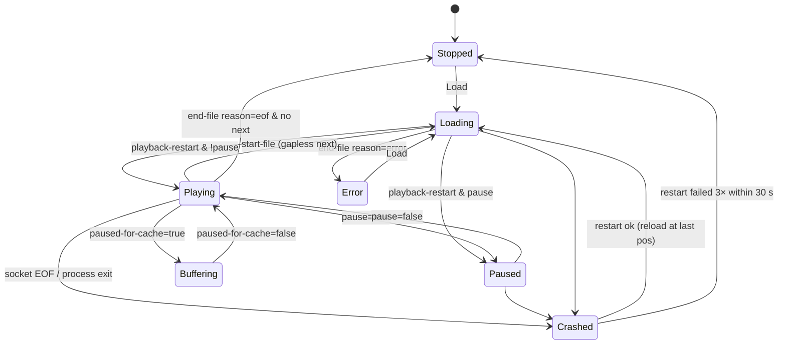

# 02 — Player: mpv over JSON IPC

Status: **draft** · Milestone: M1 (gapless/prefetch hooks finished in M3)

## Goals

- Drive `mpv` as a subprocess over its JSON IPC. No cgo, no libmpv.
- One `player.Controller` that owns the mpv process, exposes non-blocking commands, and emits
  state snapshots/events.
- Survive mpv crash/kill: restart, restore volume, reload current track at last position, and
  surface a toast. Never take the TUI down.
- Gapless transitions via mpv's internal playlist + `--prefetch-playlist`.

## Non-goals

- Video output, subtitles, mpv scripts/user `mpv.conf` loading (we pass `--no-config` by default;
  `[playback] mpv_config = true` opt-in, see open questions), equalizer UI.

## Verified protocol facts (mpv v0.41.0, probed locally 2026-11-16)

- Request: one JSON object per line: `{"command": [...], "request_id": <int>}\n`.
- Reply: `{"request_id": N, "error": "success", "data": ...}`; failures carry a string error, e.g.
  `"property not found"`.
- `loadfile <url> append-play` replies `{"data":{"playlist_entry_id":1}}`.
- Events arrive interleaved with replies: `start-file{playlist_entry_id}`, `file-loaded`,
  `playback-restart`, `audio-reconfig`, `end-file{reason,playlist_entry_id,…}`,
  `property-change{id,name,data}`.
- `observe_property <id> <name>` immediately emits the current value as a `property-change`.
- **Unix socket path limit**: a ~140-byte path failed (`AF_UNIX path too long`). Limit is 108 bytes
  on Linux, 104 on macOS. Socket dir must be short (see 01 paths) and length-checked with a clear error.

## Design

### Process

```
mpv --idle=yes --no-video --no-terminal --no-config
    --input-ipc-server=<runtime>/mpv-<pid>.sock     (Windows: \\.\pipe\ytm-go-mpv-<pid>)
    --prefetch-playlist=yes --gapless-audio=weak
    --volume=<default_volume> --volume-max=100
    --cache=yes --demuxer-max-bytes=50MiB
    --ytdl=no                                       (we resolve URLs ourselves, see 03 stream)
    [--http-header-fields=... per file via loadfile options when needed]
```

- `LC_NUMERIC=C` in the child env (the original documents mpv segfaults otherwise; harmless).
- Started lazily on first play (keeps cold start < 150 ms), or eagerly in background after first
  frame if `[playback] resume_on_launch`.
- Readiness: poll-connect the socket with backoff (5 ms → 200 ms, timeout 3 s).

### Client layers

```
transport (net.Conn: unix socket | winio named pipe)
  └─ ipc.Conn      — line reader goroutine, writer goroutine, request_id → reply chan map,
                     event chan. Context-aware Call(ctx, args...) (json.RawMessage, error).
      └─ Controller — command queue, state machine, observers, crash supervisor
```

`ipc.Conn` is mpv-agnostic and tested against `fakempv`. `Controller` interface:

```go
type Player interface {
    Load(ctx context.Context, item Item, startAt time.Duration) error // replace current
    Append(item Item) error                                          // gapless next
    ClearNext() error                                                // drop preloaded entries
    TogglePause() / Play() / Pause()
    Seek(d time.Duration, mode SeekMode)                             // relative|absolute
    SetVolume(v int) ; ToggleMute()
    State() State                                                    // copy, lock-free (atomic.Pointer)
    Events() <-chan Event                                            // TrackStarted, TrackEnded{Reason}, StateChanged, Crashed, Restarted
    Close(ctx context.Context) error
}
```

Seek/volume commands are coalesced: the command loop keeps only the newest pending value per kind,
so holding `>` produces a bounded number of IPC calls (one in flight + one pending).

### Observed properties

| id | property | → state field |
|---|---|---|
| 1 | `pause` | Paused |
| 2 | `idle-active` | Idle |
| 3 | `time-pos` | Position (throttled to UI at 4 Hz; lyrics read the latest value on demand) |
| 4 | `duration` | Duration |
| 5 | `volume` | Volume |
| 6 | `mute` | Muted |
| 7 | `playlist-pos` / `playlist-current-pos` | current entry |
| 8 | `paused-for-cache` | Buffering |
| 9 | `demuxer-cache-time` | buffered-ahead (progress bar shading, optional) |

### State machine



`end-file` reasons are mapped: `eof` → `TrackEnded{Natural}` (queue advances, history counts),
`stop`/`quit`/`redirect` → ignored, `error` → `TrackEnded{Error}` → controller asks stream layer to
**re-resolve once** (expired URL is the common cause), then skip with a toast.

### Gapless & prefetch

1. When track N starts, queue asks stream resolver for N+1 (see 03); on success the controller
   `loadfile <url> append` (no `-play`) and records `playlist_entry_id → videoID`.
2. `--prefetch-playlist=yes` lets mpv open N+1 early; transition fires `start-file` with N+1's
   entry id → controller maps it back to the track and emits `TrackStarted`.
3. Any queue mutation affecting "next" (reorder, shuffle toggle, remove, play-next) →
   `ClearNext()` (`playlist-remove` of entries after current) and re-append.
4. mpv playlist is kept to at most current + 1 entries (`playlist-remove` of played entries) so
   indexes never drift from our queue.

### Crash recovery

- Supervisor watches `cmd.Wait()` and the socket reader. On either: mark `Crashed`, emit event,
  remember `{videoID, url, position, paused, volume}`, restart with backoff 0 / 250 ms / 1 s.
- After restart: re-observe properties, set volume, `loadfile` with `start=<pos>` option, restore
  pause. Toast: "Playback engine restarted".
- 3 failures within 30 s → give up, state `Stopped`, toast with `ytm doctor` hint.
- On our own shutdown: send `quit`, wait 2 s, then `Kill`. Socket file removed in both cases.
  Stale socket files from a previous crash are removed before start (only if no process answers).

### Seek & volume

- `seek <s> relative` / `seek <s> absolute+exact`. CLI `seek 1:30` → absolute. Seeking while
  `Idle`/`Loading` is buffered and applied on `playback-restart` (original had a bug fix for
  seek-while-idle: `test_l1_seek_idle`).
- Volume clamped 0–100, persisted in session. Mute separate from volume (`_` key).

## Edge cases

- mpv not installed / wrong version (< 0.33 lacks some props) → `ErrMPVNotFound` / version warning in `doctor`.
- Socket path too long → explicit error naming the path and `XDG_RUNTIME_DIR`.
- Malformed/partial JSON line → logged, connection kept. Lines > 1 MiB → connection reset (defensive).
- Reply for unknown request_id (late after ctx timeout) → dropped.
- Two rapid `Load`s → second cancels first (generation counter; stale `start-file` ignored).
- Stream URL expired mid-track (rare, long pause) → on error re-resolve and reload at position.
- Windows: named pipe transport via `go-winio`; mpv accepts `\\.\pipe\name` for `--input-ipc-server`
  (verify on Windows CI runner in M1).

## Test plan

- `fakempv`: Go test server implementing the line protocol, scripted events, can simulate crash
  (close conn), slow replies, garbage lines. Used for all unit tests (no mpv needed in CI).
- Unit: request/reply correlation under concurrency (`-race`), event demux, coalescing (100 seeks →
  ≤ 2 IPC calls), state machine table tests from the diagram, crash restore sequence.
- Integration (tagged `//go:build mpv`, run locally and on the Linux CI job that installs mpv):
  play `av://lavfi:sine=…` generated audio (no network), pause/seek/volume, `kill -9` mpv → resumes.
- Benchmark: IPC round-trip latency, event decode throughput.

## Open questions

1. Load user's `mpv.conf`? Default **no** (`--no-config`) for reproducibility; add
   `[playback] mpv_config = false` + `mpv_args = []` escape hatch. Needs your OK (new config keys).
